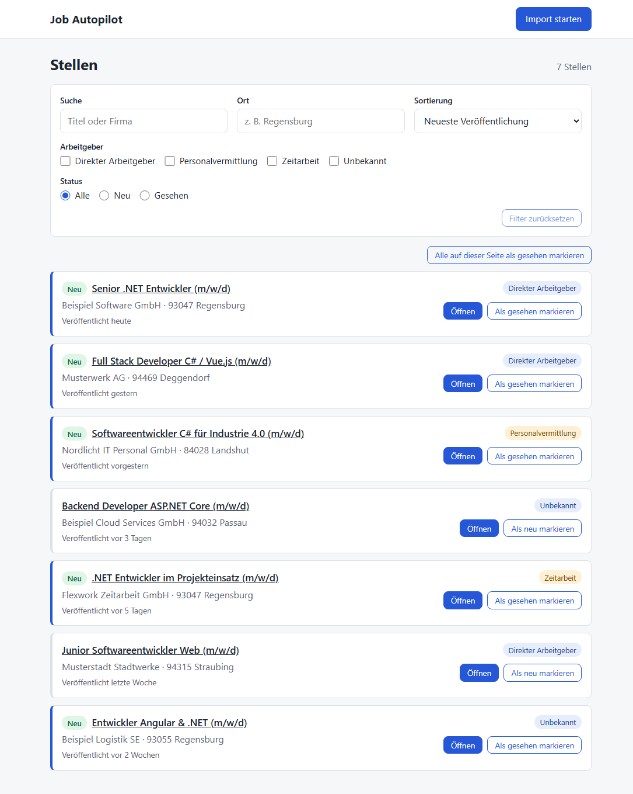

# job-autopilot

A personal tool for a structured job search in Germany: it fetches vacancies, ranks direct employers above
recruitment agencies, drafts tailored cover letters with the Claude API and tracks every application.
Nothing is ever sent without explicit human approval of that exact application.

## Quick start

Prerequisite for both: [Docker Desktop](https://www.docker.com/products/docker-desktop/) running.

```powershell
docker compose up -d     # "use" mode: db + api + frontend in Docker → http://localhost:3000
./dev.ps1                # "dev" mode: db in Docker, API (dotnet watch) + frontend (nuxt dev) in one window
```

Dev mode additionally needs the .NET 10 SDK and Node 24; Ctrl+C stops API and frontend. Details below.

**Status:** step 03 (+ 03b) of the [roadmap](docs/ROADMAP.md) — a usable vacancy list: import from the
Bundesagentur für Arbeit with one click (region around Deggendorf + fully remote jobs in all of Germany,
apprenticeships/internships filtered out), filter (text, place, employer type, new/seen, remote, search), open the
original posting, mark postings as seen; filters live in the URL. Earlier steps: foundation (01), import (02).
Agent rules: [AGENTS.md](AGENTS.md).



<sub>Demo data with fictional companies. Dark mode: [screenshot](docs/img/vacancy-list-dark.png).</sub>

## Stack

.NET 10 · ASP.NET Core (minimal APIs) · EF Core + PostgreSQL 17 · Nuxt 4 · Vue 3 · TypeScript · SCSS ·
xUnit v3 + FluentAssertions + Testcontainers · Vitest · Docker Compose · GitHub Actions (Azure later)

## Architecture

```
 ┌───────────────────┐   HTTP/JSON   ┌──────────────────────────────────────────────┐
 │ frontend (Nuxt 4) │ ────────────▶ │ JobAutopilot.Api  endpoints, DTOs, DI, config│
 │ localhost:3000    │               │        │                                     │
 └───────────────────┘               │        ▼                                     │
                                     │ JobAutopilot.Infrastructure  EF Core, Npgsql,│
                                     │        │                     external clients│
                                     │        ▼                                     │
                                     │ JobAutopilot.Core  entities, enums, rules    │
                                     │                    (references nothing)      │
                                     └──────────────────────┬───────────────────────┘
                                                            ▼
                                                  PostgreSQL 17 (Docker)
```

Dependencies point inwards: `Api → Infrastructure → Core`.
Endpoints are **minimal APIs grouped per feature** (`Features/Vacancies/VacancyEndpoints.cs`) — less ceremony than
controllers, with typed results that produce an accurate OpenAPI document.
More background: [ADR 0001](docs/decisions/0001-foundation.md) (foundation),
[ADR 0002](docs/decisions/0002-vacancy-import.md) (import), [ADR 0003](docs/decisions/0003-vacancy-list-ui.md)
(list UI), [ADR 0004](docs/decisions/0004-title-prefilter.md) (title pre-filter),
[Jobsuche API notes](docs/arbeitsagentur-api.md), [ADR 0005](docs/decisions/0005-single-import-lock.md) (one import
at a time). Security: [docs/SECURITY.md](docs/SECURITY.md) — threat model, review findings, and the rule that
**authentication comes before anything is reachable from outside localhost**.

## Run locally (Windows, PowerShell)

`.env` holds the local database credentials and the ports (copied from `.env.example` by `dev.ps1`; never
committed). All ports are bound to `127.0.0.1` only — nothing is reachable from the network
([docs/SECURITY.md](docs/SECURITY.md)).

### Use mode — everything in Docker

```powershell
Copy-Item .env.example .env            # once
docker compose up -d                   # builds the images on first start, waits for health checks
# → UI http://localhost:3000 · API http://localhost:5080/health/ready
docker compose logs -f api             # logs
docker compose down                    # stop (data stays in the "pgdata" volume)
docker compose up -d --build           # after pulling new code
```

The API container runs as non-root, applies migrations on start (`Database__MigrateOnStartup=true`) and runs in
`Production` mode. `NUXT_PUBLIC_API_BASE` is read by the frontend **at runtime**; it is the URL the *browser* uses
to call the API (all data is loaded client-side), so in compose it is `http://localhost:${API_PORT}` — the
published port, not the container name. CORS on the API allows exactly `http://localhost:${WEB_PORT}`.

### Dev mode — one window

```powershell
./dev.ps1                              # or: ./dev.ps1 -ApiPort 5081 -WebPort 3001
```

The script checks Docker / .NET / Node / `.env`, starts the `db` container and waits until it is healthy, then runs
the API with `dotnet watch` and the frontend with `nuxt dev` with prefixed output (`[api]`, `[web]`). **Ctrl+C** stops
both process trees; the database keeps running (`docker compose stop db`). It refuses to start if a port is already
in use (e.g. while use mode is running). Works in Windows PowerShell 5.1 and PowerShell 7. If scripts are blocked:
`Set-ExecutionPolicy -Scope CurrentUser RemoteSigned`.

Manual alternative: `docker compose up -d db`, `dotnet run --project backend/src/JobAutopilot.Api`,
`cd frontend; npm install; npm run dev`. Migrations are applied on start when `Database:MigrateOnStartup` is
`true` (it is in `appsettings.Development.json`).

### Backup and restore

```powershell
./scripts/backup-db.ps1                                   # → ./backups/jobautopilot-<timestamp>.sql (git-ignored)
./scripts/restore-db.ps1 ./backups/jobautopilot-20261018-213850.sql   # replaces all data, asks first
```

Stop the API before a restore. The restore runs in one transaction — on an error nothing changes.

### Import vacancies from the Arbeitsagentur

Click **Import starten** in the UI, or:

```powershell
Invoke-RestMethod -Method Post http://localhost:5080/api/imports/arbeitsagentur
# real run on 2026-10-18 (15 searches): 117 vacancies — 77 in the region, 40 fully remote
# second run: 0 neu · 0 aktualisiert · 117 unverändert · 0 ausgeschlossen
```

It runs every search in `Import:Searches` and stores new postings. Known ones are only updated; nothing you marked
as seen is reset. Every vacancy remembers which searches found it (`matchedSearches`), and vacancies found by a
remote search are marked `isRemote`.

#### Configuring searches

Edit `backend/src/JobAutopilot.Api/appsettings.json` (or override it with user-secrets / environment variables):

```jsonc
"Import": {
  "Searches": [
    // region: keyword around a place
    { "Name": "region-csharp", "Keyword": "Softwareentwickler C#", "Location": "Deggendorf", "RadiusKm": 70 },
    // remote: no Location = all of Germany, only home-office postings
    { "Name": "remote-dotnet", "Keyword": ".NET", "RemoteOnly": true, "MaxPages": 5 }
  ],
  "ExcludeTitleTerms": [ "Ausbildung", "Praktikum", "Werkstudent", "Duales Studium" ]
}
```

| Field | |
|---|---|
| `Name` | unique label (letters, digits, `-`, `_`); shown in the UI filter „Suche" |
| `Keyword` | search text. Bare `C#` / `.NET` match a lot of unrelated postings in a region (licence class C, "net…"); combine them, e.g. `Softwareentwickler C#`, `C# .NET`, `.NET Entwickler` |
| `Location`, `RadiusKm` | place and radius in km; leave `Location` out for all of Germany (`RadiusKm` then is an error) |
| `PublishedWithinDays` | default 30 |
| `RemoteOnly` | only home-office postings, see `Arbeitsagentur:RemoteHomeOfficeFilter` below |
| `MaxPages` | per-search page limit (default `Arbeitsagentur:MaxPages` = 10 × 100 results) |

`ExcludeTitleTerms` is a coarse pre-filter: titles containing one of the terms as a whole word or phrase
(case-insensitive) are not stored and are counted as „ausgeschlossen" (`Ausbildung` excludes „Ausbildung zum
Fachinformatiker", not „Ausbildungsleiter"). Invalid search configuration stops the API at start-up with a clear
message.

`Arbeitsagentur:RemoteHomeOfficeFilter` decides what "remote" means: `prozentual_100` (default) = postings that state
100 % home office; `prozentual_0;nv_true` = any home office incl. "nach Vereinbarung" (about 20× more results,
mostly hybrid). Details and measured numbers: [docs/arbeitsagentur-api.md](docs/arbeitsagentur-api.md).

One ad-hoc search instead of the configured ones (same fields, camelCase; `name` defaults to `ad-hoc`):

```powershell
Invoke-RestMethod -Method Post http://localhost:5080/api/imports/arbeitsagentur -ContentType 'application/json' `
  -Body '{ "keyword": "Vue", "remoteOnly": true }'
```

### Create a vacancy by hand

```powershell
Invoke-RestMethod -Method Post http://localhost:5080/api/vacancies -ContentType 'application/json' `
  -Body '{ "title": "Senior .NET Developer", "company": "Beispiel GmbH", "location": "Berlin", "employerType": "Direct" }'
```

If you change the credentials in `.env`, set the matching connection string as a user secret:

```powershell
dotnet user-secrets set "ConnectionStrings:Default" "Host=localhost;Port=5432;Database=jobautopilot;Username=…;Password=…" `
  --project backend/src/JobAutopilot.Api
```

### API

| Method | Path | |
|---|---|---|
| GET | `/health/live` | process is up: `{ "status": "ok", "checks": {} }` |
| GET | `/health/ready` | ready to serve: `{ "status": "ok", "checks": { "database": "Healthy" } }`, 503 if the DB is unreachable |
| GET | `/api/vacancies` | paged `{ items, page, pageSize, totalCount }`, filters below |
| GET | `/api/vacancies/{id}` | one vacancy, 404 if unknown |
| PATCH | `/api/vacancies/{id}` | `{ "isSeen": true \| false }` → 204; no other field is patchable |
| POST | `/api/vacancies/seen` | `{ "ids": [...] }` (1–100) → 204, marks them as seen |
| POST | `/api/vacancies` | create a manual vacancy |
| POST | `/api/imports/arbeitsagentur` | import: empty body = configured searches, or one search `{ name, keyword, location, radiusKm, publishedWithinDays, remoteOnly, maxPages }`; returns `{ fetched, added, updated, unchanged, excluded, durationMs, searches: [...] }`; 409 while another import runs, 429 after 6 imports/min, 502 if the Arbeitsagentur API is unreachable |
| GET | `/api/imports/searches` | the configured searches (for the UI filter) |

Query parameters of `GET /api/vacancies`:

| Parameter | |
|---|---|
| `q` | text in title or company (case-insensitive, matched literally) |
| `location` | text in the location |
| `employerType` | `Direct`, `Agency`, `Temporary`, `Unknown` — repeatable |
| `seen` | `true` / `false`; omitted = all |
| `source` | `Arbeitsagentur` / `Manual` |
| `remote` | `true` = found by a remote search, `false` = the others |
| `search` | name of a configured search — repeatable, matches any |
| `sort` | `published` (default, newest first, without date last) or `fetched` |
| `page`, `pageSize` | default 1 / 20, `pageSize` ≤ 100 |

Invalid values return `400` ProblemDetails naming the parameter.

### Database migrations

```powershell
dotnet tool restore
dotnet ef migrations add <DescriptiveName> --project backend/src/JobAutopilot.Infrastructure `
  --startup-project backend/src/JobAutopilot.Api --output-dir Persistence/Migrations
```

## Tests

```powershell
dotnet test backend/JobAutopilot.sln           # unit + integration tests
cd frontend; npm test; npm run typecheck      # Vitest: URL filters, dates, URL safety, list states
```

Integration tests run the real API in memory (`WebApplicationFactory`) against **real PostgreSQL started by
Testcontainers**, so constraints, enum mapping and migrations are tested exactly as they run in production.
External services are never called from tests: the Arbeitsagentur client is tested with a fake
`HttpMessageHandler` and hand-written fixtures (`tests/JobAutopilot.Tests/Fixtures/arbeitsagentur/`), the endpoint
with a fake `IVacancySource`. Without Docker the integration tests are skipped locally (in CI they fail instead).
To use an existing PostgreSQL server instead of a container — a temporary database is created and dropped on it:

```powershell
$env:JOBAUTOPILOT_TEST_POSTGRES = "Host=localhost;Port=5432;Username=jobautopilot;Password=jobautopilot"
dotnet test backend/JobAutopilot.sln
```

## Repository layout

```
backend/   JobAutopilot.sln, src/{Api,Core,Infrastructure}, tests/JobAutopilot.Tests
frontend/  Nuxt 4 app: app/pages (list, detail), app/components, app/composables/useVacanciesApi.ts,
           app/utils (URL filters, dates, URL safety — unit-tested in frontend/test)
docs/      roadmap, architecture decisions, API notes
prompts/   task prompts, one per roadmap step
scripts/   backup-db.ps1, restore-db.ps1
dev.ps1    dev mode in one window
```
