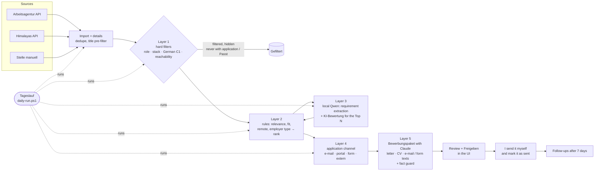

# Architecture

job-autopilot fetches job postings for one developer, scores them against his profile and Suchprofil, and helps
draft, review and track applications. Everything runs locally (Docker or `dev.ps1`); nothing is sent without an
explicit approval in the UI. Where a feature lives in the code: [CODEMAP.md](CODEMAP.md).

## Layers

| Layer | Project | Contains |
|---|---|---|
| Core | `backend/src/JobAutopilot.Core` | entities, enums, interfaces (`IVacancySource`, `IVacancyStore`, `ILetterGenerator`, `IImportLock` …), rules: scoring, fit, detection, Suchprofil, workflow |
| Infrastructure | `backend/src/JobAutopilot.Infrastructure` | EF Core `AppDbContext` + migrations, Arbeitsagentur/Himalayas/Claude clients, PDF renderer, file stores, DI (`DependencyInjection.cs`) |
| Api | `backend/src/JobAutopilot.Api` | minimal-API endpoints per feature (`Features/*`), DTOs, background workers, security middleware, `Program.cs` |
| frontend | `frontend/app` | Nuxt 4 pages, components, composables (API calls), pure `utils/` (tested with Vitest) |

Dependency rule: `Api → Infrastructure → Core`; Core references nothing. The frontend talks only to the API
(`NUXT_PUBLIC_API_BASE`).

## The pipeline (layers 1–5)

Cheap and deterministic first; the local model only sees vacancies the rules let through; Claude only the few I
prepare; nothing leaves the tool without my approval and my own sending.

| Layer | Where | Cost |
|---|---|---|
| 1 Hard filters | `Core/Filters/HardFilters.cs` | rules, free |
| 2 Rules | `Core/Scoring`, `Core/Fit` | rules, free |
| 3 Local model | `Infra/Llm` (`VacancyExtractionService`, `VacancyFitScoreService`), Ollama `qwen3:8b` | ~4 s + 2 s per vacancy on the GPU |
| 4 Channel | `Core/Applications/HowToApply.cs` (+ the extraction's `application`) | rules, free |
| 5 Package | `Infra/Documents` (`LetterGenerator`, `PackageTextGenerator`), Claude | ~0.04 $ per package, `Claude:DailyCallLimit` |

## Data flows

**Import → details → scoring/fit → list**
1. `POST /api/imports` (button) or `ImportScheduler` (daily) takes the searches generated from the Suchprofil
   (`SearchProfileImports.Current` → `SearchProfileRules.GenerateSearches`) and queues a job in `ImportJobChannel`.
2. `ImportWorker` takes the import lock and calls `VacancyImportService.ImportAsync` for every `IVacancySource`
   (Arbeitsagentur, Himalayas).
3. Candidates pass `TitleExclusionFilter`, are de-duplicated (`DuplicateKeys`) and stored via `IVacancyStore`.
4. `VacancyDetailsService.FetchAsync` loads descriptions of new/changed vacancies (capped per run).
5. `VacancyEnricher.Apply` sets relevance (`RelevanceScorer`), remote level (`RemoteClassifier`), employer type
   (`EmployerClassifier`), required German (`GermanRequirementDetector`) and rank = relevance − fit penalties
   (`FitAnalyzer` via `VacancyFitService`, with the technology catalog and the reachability rule → `Unreachable`).
6. `GET /api/vacancies` filters/sorts in SQL (`VacancyQueryExtensions`), returns facets; the detail page asks
   `GET /api/vacancies/{id}/fit` for the full „Passt zu mir?" check.

**Suchprofil → generated searches → re-score**
1. `suchprofil.vue` edits; `POST /api/search-profile/preview` shows generated searches and a diff summary.
2. `PUT /api/search-profile` validates (`SearchProfileRules.Validate`), saves a version (`SearchProfileStore`,
   history + rollback) and requests a re-score (`RescoreCoordinator`).
3. `RescoreWorker` (also at start-up when `Relevance:RescoreOnStartup`) runs `VacancyRescoreService.RescoreAllAsync` under the import lock.
4. The next import uses the new searches.

**Requirement extraction (optional, local model)**
1. After an import (or „Mit KI analysieren" / „Alle analysieren") the `ExtractionCoordinator` queues vacancies.
2. `ExtractionWorker` → `VacancyExtractionService`: cache lookup (hash + model + prompt), else one call to
   `ILlmRouter` (task `Extraction`), validation, one retry; result cached in `VacancyExtractions`, copied to the vacancy.
3. `VacancyEnricher` re-scores: `FitAnalyzer` takes requirements, German and years from the extraction (source „KI").
4. Without Ollama nothing is queued and the rules decide (source „Regeln"). The enricher also stores
   `RuleRankScore` — the same rank without the extraction — for the sort „Nur Regeln" and the evaluation (07c).
5. Stored extractions pass `ExtractionGuards` again on read, so a fixed guard applies without a new model call.

**Hard filters (layer 1, 08b)**
1. `VacancyEnricher` runs `HardFilters.Check` after scoring: role type, stack, explicit German C1, reachability (the
   Suchprofil's „Nicht erreichbare ausblenden") → `Vacancy.FilterReason`.
2. The list, the channel statistics and the extraction / KI-Bewertung queues use `WithoutFiltered`: a vacancy with an
   application or my „Passt" label is never left out.

**Bewerbungspaket → Heute bereit → follow-up (08c)**
1. `POST /api/vacancies/{id}/package` (or `POST /api/packages/top?k=5` after `GET /api/packages/estimate`): the
   documents service creates the draft (letter.v2 + CV) if needed, then `CreatePackageAsync` asks
   `IPackageTextGenerator` (Claude) for the e-mail body, motivation and „Über mich" and runs the fact guard on them.
2. `GET /api/applications/{id}/package` adds the channel (`HowToApplyDetector.Resolve`), attachment names and the
   portal checklist; `package.zip` serves the approved PDFs. Nothing is sent: I copy, attach and send myself, then
   `POST …/mark-sent`.
3. `GET /api/follow-ups` lists open applications 7 days after the last action with template texts
   (`FollowUps.Draft`); `POST …/follow-up-done` makes the follow-up the new last action.

**Tageslauf (08b)**
`DailyRunWorker` queues an import and waits for it, requests a re-score (hard filters + rules) and waits, probes the
local model (`ILocalModelProbe`) and — if it answers — asks the extraction worker for the Top N and waits, then computes
the channels of the Top 20 and a summary. One run at a time; a second request joins it.

**Ranking evaluation (07c)**
1. Labels = my explicit gold labels + automatic ones (`LabelSet`: applied → Passt, Ausblenden → Passt nicht).
2. `GET /api/evaluation/ranking` orders the labelled vacancies per variant (rules, combined, KI, rank + w × KI) and
   computes `RankingMetrics` (P@10, P@20, NDCG@20).
3. `POST /api/evaluation/model-run?model=…` lets another model extract and score the labelled vacancies
   (`LlmRequest.Model` override, same provider); results go only to the caches, then step 2 adds its variants.

**Applications and tracker import**
1. `POST /api/vacancies/{id}/apply` or `/documents` creates an `Application` (status `Draft`).
2. Documents: `ApplicationDocumentsService` → `ILetterGenerator` (`LetterGenerator` → `ILlmRouter` → Claude) + `CvBuilder`, checked by `FactGuard`;
   the user edits, previews and approves (`ApplicationWorkflow.Approve`), PDFs via `QuestPdfDocumentRenderer`.
3. Sending is manual; `POST /api/applications/{id}/mark-sent` records it (`ApplicationWorkflow.MarkSent`).
4. Status changes via `POST /api/applications/{id}/status`; follow-up = last action + 7 days.
5. `POST /api/applications/import-tracker` reads the old tracker file (`TrackerImporter`, `ApplicationMatcher`).

## External systems

| System | Client | Notes |
|---|---|---|
| Bundesagentur für Arbeit Jobsuche | `Infrastructure/Arbeitsagentur/ArbeitsagenturClient` | search + details, typed `HttpClient` |
| Himalayas | `Infrastructure/Himalayas/HimalayasClient` | remote jobs, HTML → text (`HtmlText`) |
| Claude API | `Infrastructure/Claude/ClaudeLlmClient` behind `ILlmRouter` (`Llm:Tasks`) | letters only; key via user-secrets/env; prompt `Prompts/letter.v1.md` |
| Ollama (local) | `Infrastructure/Llm/OllamaLlmClient` behind `ILlmRouter` (`Llm:Tasks:Extraction`) | requirement extraction; off by default; OpenAI-compatible API, `GET /api/llm/status` |

All are behind Core interfaces and faked in tests (`tests/.../Fakes`, stub `HttpMessageHandler`s).

## Background jobs and locks

- `ImportWorker` — consumes `ImportJobChannel`, one import at a time; progress in `ImportRun` rows.
- `ImportScheduler` — daily auto-import (`Import:Schedule`, `DailySchedule`, Europe/Berlin).
- `RescoreWorker` — re-scores on request and at start-up.
- `ExtractionWorker` — requirement extraction with the local model, one GPU job at a time; after imports and on
  request (`ExtractionCoordinator`), no import lock.
- `SearchProfileInitializer` — seeds the Suchprofil on first start (`SearchProfileDefaults`, legacy `preferences`).
- `PostgresImportLock` — PostgreSQL advisory lock shared by import and re-score, works across processes.

## Security

`ApiSecurity`: CORS for configured origins only, security headers, rate limit on imports, ProblemDetails errors.
Frontend CSP in `frontend/server/plugins/content-security-policy.ts`. Details: [SECURITY.md](SECURITY.md).

## Decisions (ADR)

- [0001](decisions/0001-foundation.md) — foundation: stack, layers, Docker.
- [0002](decisions/0002-vacancy-import.md) — vacancy import from the Arbeitsagentur.
- [0003](decisions/0003-vacancy-list-ui.md) — vacancy list UI.
- [0004](decisions/0004-title-prefilter.md) — title pre-filter.
- [0005](decisions/0005-single-import-lock.md) — single import lock.
- [0006](decisions/0006-background-import-queue.md) — background import queue.
- [0007](decisions/0007-daily-auto-import.md) — daily auto-import.
- [0008](decisions/0008-second-source-himalayas.md) — second source Himalayas.
- [0009](decisions/0009-search-profile.md) — Suchprofil.
- [0010](decisions/0010-application-documents.md) — application documents.
- [0011](decisions/0011-requirement-importance-and-german.md) — requirement importance, required German.
- [0012](decisions/0012-technology-catalog-and-reachability.md) — technology catalog, profile-gated keywords, reachability.
- [0013](decisions/0013-llm-abstraction.md) — ILlmClient and task routing (`Llm:Tasks`).
- [0014](decisions/0014-local-llm-extraction.md) — Ollama, requirement extraction, gold labels.

Schema: [schema.md](schema.md). Roadmap: [ROADMAP.md](ROADMAP.md).
